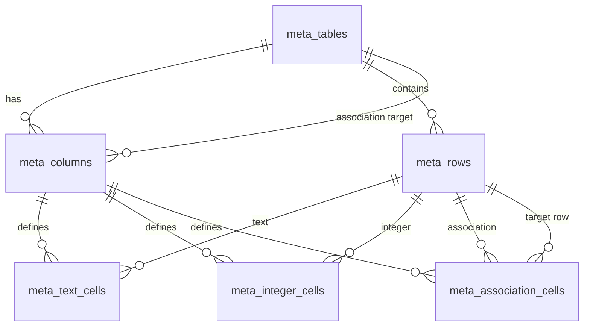

# Metadata-defined tables (design)

## Problem

You want to introduce new logical tables without writing `CREATE TABLE` for each one. Schema changes should be **data** (metadata rows), while still supporting typed columns and **associations** between rows in different logical tables.

## Approach: fixed meta-schema + typed cell storage

Use a **small, stable SQL schema** that never grows when you add business tables. New tables are rows in `meta_tables`; new fields are rows in `meta_columns`. Instance data lives in generic row/cell tables.

This is not classic single-table EAV (one `value` column for everything). Typed side tables keep integers indexable and associations explicit.

### Metadata

| Entity | Purpose |
|--------|---------|
| `MetaTable` | Logical table: stable `Key` (slug), display name |
| `MetaColumn` | Field on a table: `Name`, `Kind` (`Text`, `Integer`, `Association`), optional `AssociationTargetTableId`, `IsRequired`, `SortOrder` |

### Instance data

| Entity | Purpose |
|--------|---------|
| `MetaRow` | One record in a logical table |
| `MetaTextCell` | `(RowId, ColumnId) → string` |
| `MetaIntegerCell` | `(RowId, ColumnId) → int` |
| `MetaAssociationCell` | `(RowId, ColumnId) → TargetRowId` (row in another logical table) |

Unique constraints: one cell per `(RowId, ColumnId)` per value table. Application code validates that column kind matches the cell table used.

### Adding a new table (no DDL)

1. Insert `MetaTable` (`Key = "invoice_line"`, …).
2. Insert `MetaColumn` rows (`Kind = Text`, `Integer`, or `Association` with `AssociationTargetTableId` pointing at another `MetaTable`).
3. Insert `MetaRow` + cells for data.

The POC implements this in `MetaTableStore` (`MetaTable.Infrastructure`).

## Associations

- An association column names a **target logical table** via `AssociationTargetTableId`.
- The stored value is **`TargetRowId`** (GUID of a row in that table).
- On write, validate: target row exists and belongs to the declared target table.
- Cardinality: model supports **many-to-one** (single target row per cell). One-to-many from the parent side is modeled as multiple rows pointing at the same target, or a future `AssociationCardinality` flag.

## Query and reporting

| Need | Recommendation |
|------|----------------|
| App CRUD, pack-driven extensions | Metadata + cell tables (this POC) |
| Heavy SQL reporting / joins | Metadata **plus** view or codegen (see below) |
| Tenant-specific columns on core ERP entities | Prefer Platform 2.0 customization packs + extension bags (`platform-ui-customization-standard.md`), not anonymous meta-tables for core aggregates |

For list screens, load rows for one `MetaTableId`, join cells for declared columns, resolve association display values in a second batch query (same pattern as N+1-safe extension loads).

## Alternatives

| Pattern | When |
|---------|------|
| **Pure EAV** (one `Value` string column) | Maximum flexibility; weak typing and indexing |
| **JSON document per row** | Few columns, schema varies a lot; good for blobs, harder for association integrity |
| **Metadata → migrations/codegen** | Metadata is source of truth but you still get real SQL tables for performance |
| **Legacy Text\*/Bool\*** | Fixed column pool on core tables—avoid for new V2 core (see `tenant-workflow-fields-deepdive-instructions.md`) |

## Validation rules (enforce in application)

1. Column `Kind` must match the cell table used on write.
2. Required columns must have a cell before the row is considered complete.
3. Association targets must exist and match `AssociationTargetTableId`.
4. `MetaTable.Key` and `(TableId, Column.Name)` should be unique.

## Reference code

- Domain enums and read model: `MetaTablePoc/src/MetaTable.Domain/`
- EF Core persistence and store: `MetaTablePoc/src/MetaTable.Infrastructure/`
- Example: department + employee with association — `MetaTable.Tests/Integration/MetaTableStoreShould.cs`
